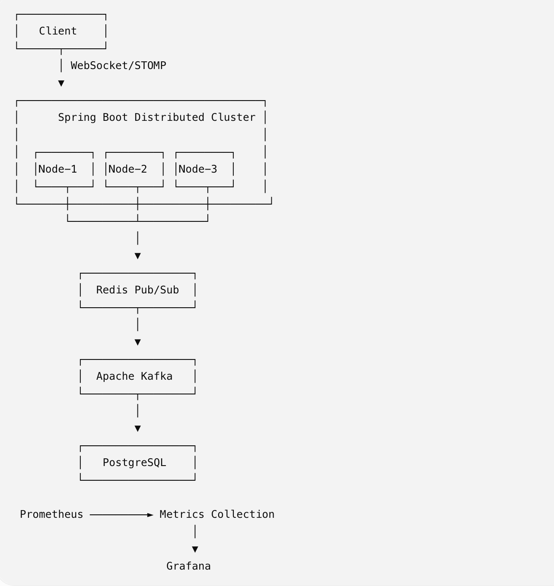
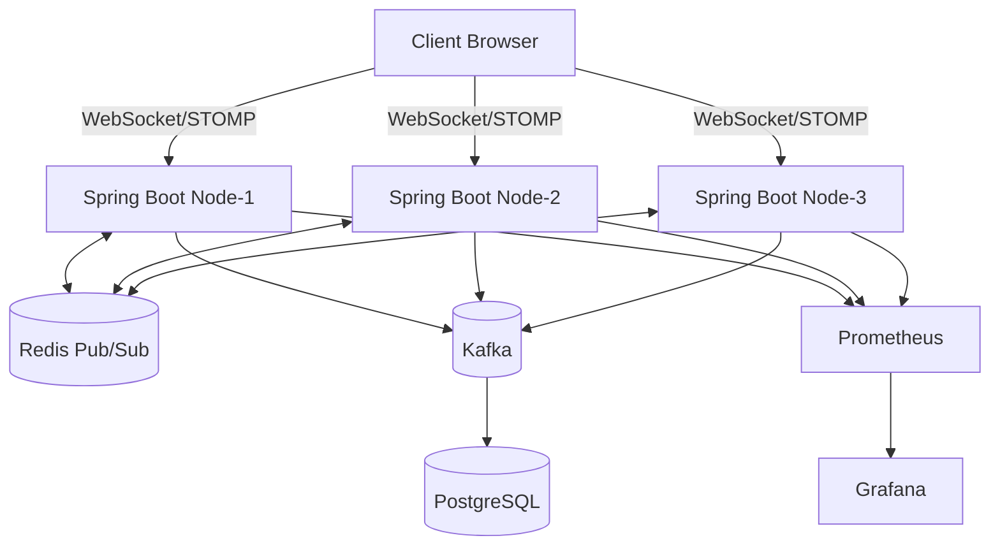
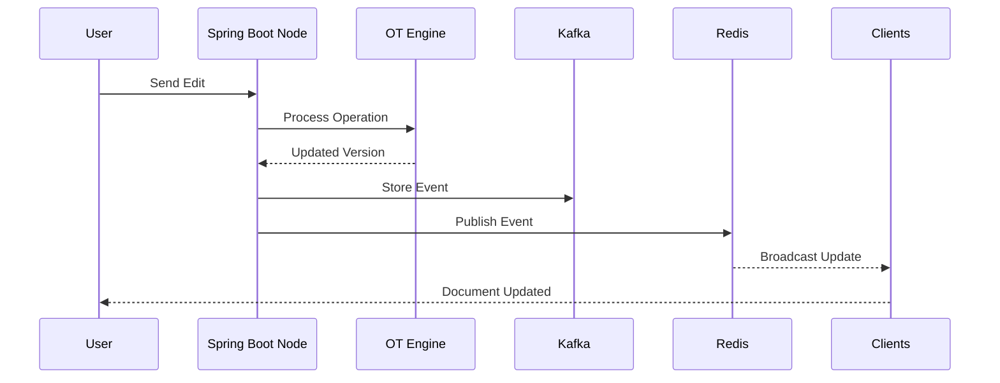
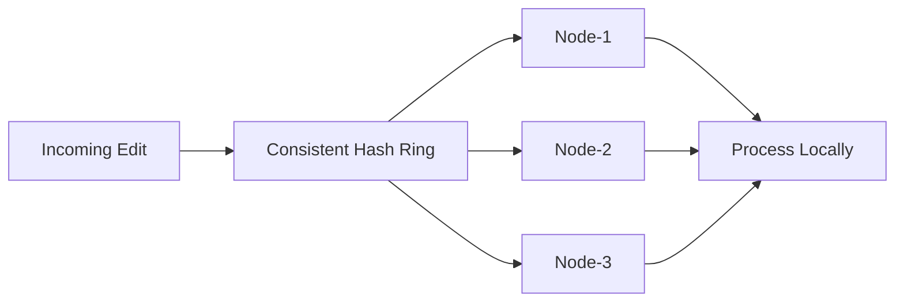
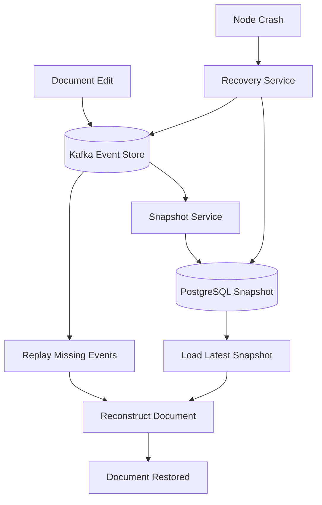
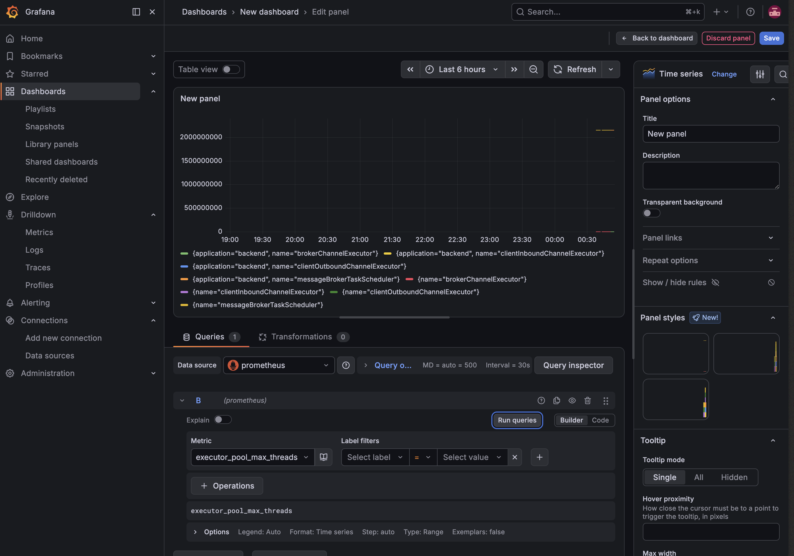
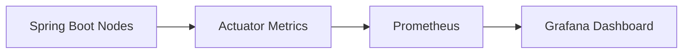
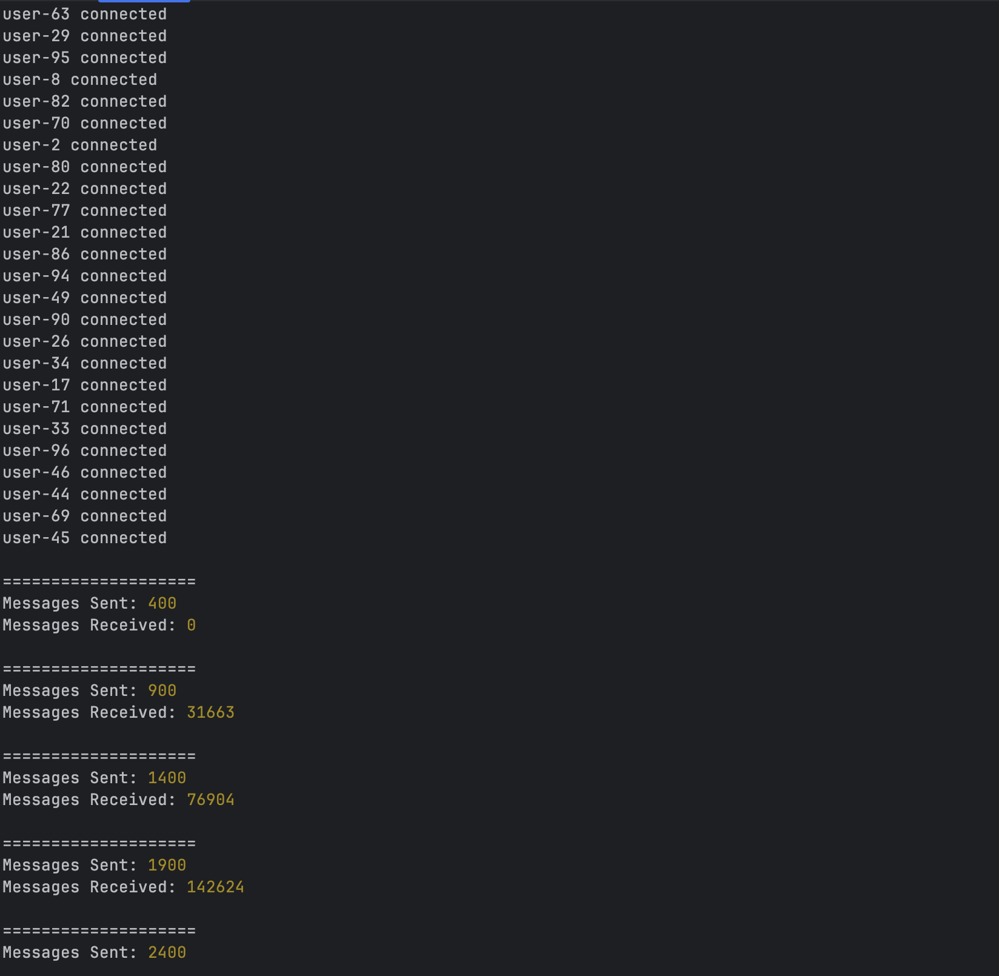

# Real-Time Collaborative Sync Engine

A distributed real-time collaborative editing platform built using Spring Boot, WebSockets, Redis, Kafka, PostgreSQL, Prometheus, and Grafana.

The system enables multiple users to collaboratively edit documents in real time while maintaining consistency through Operational Transformation (OT), distributed synchronization, event sourcing, and snapshot-based recovery.

---

# Architecture Overview



---

# System Architecture



---

# Features

## Real-Time Collaboration

* Multi-user collaborative editing
* WebSocket + STOMP communication
* Live document synchronization
* Presence tracking
* Real-time broadcasting

## Consistency & Conflict Resolution

* Operational Transformation (OT)
* Document versioning
* Concurrent edit handling
* Conflict resolution

## Distributed Architecture

* Consistent hashing
* Request routing
* Redis Pub/Sub synchronization
* Horizontal scalability

## Reliability & Recovery

* Kafka event sourcing
* Snapshot-based recovery
* Event replay mechanism
* Fault-tolerant reconstruction

## Observability

* Spring Boot Actuator
* Prometheus metrics
* Grafana dashboards
* Custom metrics

---

# Collaborative Edit Flow



---

# Distributed Request Routing



### Routing Logic

```text
Document ID
     ↓
Consistent Hash Ring
     ↓
Owner Node
     ↓
Process Operation
```

---

# Recovery Mechanism



### Example Recovery

```text
Latest Snapshot Version = 100

Kafka Events:
101
102
103
104

Node Crash

Recovery:
Load Snapshot(100)
Replay(101-104)

Final Version = 104
```

---

# Monitoring





Metrics exposed via:

```text
/actuator/prometheus
```

Tracked Metrics:

* Active users
* Active documents
* Operations processed
* JVM memory
* CPU utilization
* WebSocket connections

---

# Load Testing



## Sample Benchmark Results

| Concurrent Users | Messages Sent | Messages Received | Avg Latency |
| ---------------- | ------------- | ----------------- | ----------- |
| 100              | 2,400         | 170,407           | 45 ms       |
| 250              | 6,000         | 435,000           | 72 ms       |
| 500              | 12,000        | 910,000           | 118 ms      |


### Run Benchmark

```bash
node load-tests/collaborative/collab-edit-test.js
```

---

# Tech Stack

### Backend

* Java 21
* Spring Boot
* Spring WebSocket
* Spring Data JPA
* Spring Actuator

### Messaging & Streaming

* Redis Pub/Sub
* Apache Kafka

### Database

* PostgreSQL

### Monitoring

* Prometheus
* Grafana

### DevOps

* Docker
* Docker Compose
* Kubernetes
* GitHub Actions

### Testing

* k6
* Custom Collaborative Load Testing

---

# Project Structure

```text
backend/
docs/
load-tests/
k8s/
docker-compose.yml
README.md
```

---

# Running Locally

```bash
docker compose up -d

mvn spring-boot:run -Dspring-boot.run.profiles=node1
mvn spring-boot:run -Dspring-boot.run.profiles=node2
mvn spring-boot:run -Dspring-boot.run.profiles=node3
```

---

# Services

| Service     | URL                                         |
| ----------- | ------------------------------------------- |
| Application | http://localhost:8080                       |
| Swagger UI  | http://localhost:8080/swagger-ui/index.html |
| Prometheus  | http://localhost:9090                       |
| Grafana     | http://localhost:3000                       |

---

# Future Improvements

* CRDT-based synchronization
* Leader election and failover
* Dynamic service discovery
* Authentication & authorization
* Multi-region deployment
* Auto-scaling
* Advanced conflict resolution

---

# Learning Outcomes

* Distributed Systems Design
* Event-Driven Architecture
* Operational Transformation
* Kafka Event Sourcing
* Redis Distributed Messaging
* WebSocket Communication
* Observability & Monitoring
* Performance Engineering
* Docker & Kubernetes
* Load Testing & Benchmarking


# License

This project is intended for learning, experimentation, and demonstrating distributed systems concepts.
